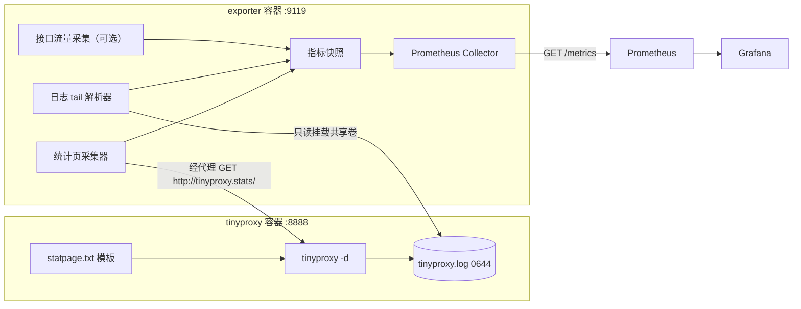

# tinyproxy-exporter

[](LICENSE)
[](exporter/go.mod)
[](https://github.com/zzhkhyl/tinyproxy-exporter/actions/workflows/ci.yml)
[](https://github.com/zzhkhyl/tinyproxy-exporter/actions/workflows/release.yml)

把 Tinyproxy 的运行数据以 Prometheus 格式暴露出来的一套可部署方案：

- `tinyproxy/` —— 基于 Alpine 定制的 Tinyproxy 容器镜像，默认监听 `8888`，开启 `StatHost` 统计页与详细日志，并带一份机器可读的统计页模板。
- `exporter/` —— Go 编写的 Prometheus Exporter，通过**统计页抓取**与**日志增量解析**两条独立通道采集指标，在 `/metrics` 暴露。
- `docker-compose.yml` / `docker-compose.dev.yml` —— 生产与开发测试两套双容器编排。
- `k8s/`、`prometheus/`、`grafana/` —— 单文件 Kubernetes 清单、抓取示例与可直接导入的 Grafana 仪表盘。

> 用于对齐解析规则的 `tinyproxy-master/`（上游源码副本，GPL-2.0）不参与构建，也不包含在本仓库中，见 [`.gitignore`](.gitignore)。

---

## 特性

- **两条独立采集通道**：统计页抓取与日志增量解析互不影响，任一失败只体现在 `tinyproxy_exporter_source_up{source}` 上，Exporter 不会退出。
- **兼容三种统计页形态**：自定义 `StatFile` 模板、Alpine 自带的 HTML 表格、以及未配置 `StatFile` 时的硬编码页面。
- **日志健壮**：自适应 `copytruncate` 与 `create` 两种轮转方式，容忍截断、半行与"Exporter 先于代理启动"的竞态。
- **自抓取隔离**：Exporter 自己的统计页请求单列为 `tinyproxy_log_stathost_requests_total`，不污染业务请求指标。
- **站点过滤（默认关闭）**：可选的 `Filter` 白名单与配套文档；默认不启用，避免一个代理镜像的开箱行为被硬编码域名清单限制。被拒请求计入 `tinyproxy_log_denied_total{reason="filter"}`。
- **开箱可观测**：附 ServiceMonitor、PrometheusRule 告警规则，以及 17 个面板的 Grafana 仪表盘。

---

## 架构



两条通道互相独立：任一通道失败都只在对应的 `tinyproxy_exporter_source_up{source}` 上体现，不影响另一条通道，也不会让 Exporter 退出。

---

## 快速开始

两套 compose 配置：生产用 `docker-compose.yml`（拉取 GHCR 上的 `latest` 镜像），开发测试用 `docker-compose.dev.yml`（在本地构建镜像）。

不打算用 compose 的话，也可以单独取镜像或安装二进制（`<owner>` 为仓库所属账号）：

```bash
docker pull ghcr.io/<owner>/tinyproxy-exporter:latest
go install github.com/zzhkhyl/tinyproxy-exporter@latest
```

compose 的最短路径：

```bash
# 生产：拉取镜像并启动
docker compose up -d

# 开发测试：本地构建并启动
docker compose -f docker-compose.dev.yml up -d --build

# 使用代理（示例：走代理访问一个地址）
curl -x http://127.0.0.1:8888 http://example.com/

# 直接查看 Tinyproxy 的统计页（必须经代理请求）
curl -s -x http://127.0.0.1:8888 http://tinyproxy.stats/

# 查看指标与健康状态
curl -s http://127.0.0.1:9119/metrics | grep '^tinyproxy'
curl -s http://127.0.0.1:9119/healthz
```

两套配置的取舍见下文[开发测试与生产部署](#开发测试与生产部署)。

如果构建主机访问不了 `dl-cdn.alpinelinux.org` 或 `proxy.golang.org`（例如只有 IPv6 解析、或纯内网），把镜像源指到可用地址即可（只影响本地构建的开发测试配置）：

```bash
cp .env.example .env
# 编辑 .env：
#   APK_MIRROR=https://mirrors.aliyun.com/alpine
#   GOPROXY=https://mirrors.aliyun.com/goproxy,direct
docker compose -f docker-compose.dev.yml up -d --build
```

同样的参数也可用于 Makefile：`make images APK_MIRROR=... GOPROXY=...`。

---

## 开发测试与生产部署

仓库里有三套等价的部署方式，生产侧镜像统一来自 GHCR 的 `ghcr.io/<owner>/tinyproxy` 与 `ghcr.io/<owner>/tinyproxy-exporter`（`<owner>` 即仓库所属账号）：

| 配置 | 用途 | 镜像 |
| --- | --- | --- |
| `docker-compose.yml` | 生产部署 | GHCR `latest`，`pull_policy: always` 每次重新拉取 |
| `docker-compose.dev.yml` | 开发测试 | 本地 `build:`（`up --build` 即时生效） |
| `k8s/tinyproxy.yaml` | Kubernetes 部署 | GHCR `latest`，`imagePullPolicy: Always` |

`latest` 由 [`.github/workflows/release.yml`](.github/workflows/release.yml) 在打 tag 时发布，见[发布镜像到 GHCR](#发布镜像到-ghcr)。

两套 compose 的差异：

| 维度 | 生产 `docker-compose.yml` | 开发测试 `docker-compose.dev.yml` |
| --- | --- | --- |
| 服务定义 | `image: …:latest` + `pull_policy: always`，不在本机构建；设 `restart: unless-stopped`、`mem_limit`/`cpus` 与日志轮转上限 | `build:` 指向本地 Dockerfile，`up --build` 即时打包；不设资源与日志上限 |
| 网络配置 | 端口只绑回环（`TINYPROXY_BIND` / `EXPORTER_BIND` 默认 `127.0.0.1`），代理不默认暴露到公网 | 端口绑 `0.0.0.0`，便于从局域网或同级容器调试 |
| 数据卷 | 命名卷 `tinyproxy-logs`，日志随 compose 项目持久化；另以 `${TINYPROXY_CONF}` 只读挂载覆盖镜像内的默认配置 | 绑定挂载 `./data/logs`（宿主机可直接 `tail -f`）与 `./tinyproxy/tinyproxy.conf`，改完重启容器即生效 |
| 环境变量 | `LOG_LEVEL=info`、`TINYPROXY_LOG_FROM_START=false`（只统计启动之后的请求，避免重启时把历史日志回放成尖峰） | `LOG_LEVEL=debug`、`TINYPROXY_LOG_FROM_START=true`（从头解析既有日志，便于验证日志分类器） |
| 项目标识 | `name: tinyproxy` | `name: tinyproxy-dev`（网络与卷都不与生产冲突，两套可共存） |

两套默认都映射宿主机 `8888` / `9119`，需要同时运行时给其中一套换端口：

```bash
TINYPROXY_PORT=8889 EXPORTER_PORT=9120 \
  docker compose -f docker-compose.dev.yml up -d --build
```

Makefile 对应 `make up` / `make up-dev`（`down` / `down-dev`、`logs` / `logs-dev` 同理）。

---

## 端点

| 端口 / 路径 | 说明 |
| --- | --- |
| `8888` (tinyproxy) | HTTP 代理端口；请求 `Host: tinyproxy.stats` 会返回统计页 |
| `9119/metrics` | Prometheus 文本格式指标（含 `go_*`、`process_*` 运行时指标） |
| `9119/healthz` | 各数据源状态 JSON；至少一个数据源健康返回 `200`，全部不可用返回 `503` |
| `9119/` | 简单说明页 |

---

## 指标

分四组：StatHost 统计页、日志解析、Exporter 自身、可选的接口流量。

完整清单（指标名、类型、标签，以及两个容易混淆的口径说明）见 [`docs/metrics.md`](docs/metrics.md)。

---

## 配置

全部通过环境变量配置（12-factor），完整清单与默认值见 [`.env.example`](.env.example)。

| 变量 | 默认值 | 说明 |
| --- | --- | --- |
| `EXPORTER_LISTEN_ADDRESS` | `:9119` | Exporter 监听地址 |
| `EXPORTER_METRICS_PATH` | `/metrics` | 指标路径 |
| `LOG_LEVEL` | `info` | `debug`/`info`/`warn`/`error` |
| `TINYPROXY_STATS_ENABLED` | `true` | 是否启用统计页通道 |
| `TINYPROXY_PROXY_URL` | `http://tinyproxy:8888` | 代理地址（统计页请求经此发出） |
| `TINYPROXY_STATS_HOST` | `tinyproxy.stats` | 必须与 `tinyproxy.conf` 的 `StatHost` 一致 |
| `TINYPROXY_STATS_INTERVAL` | `15s` | 统计页抓取周期 |
| `TINYPROXY_STATS_TIMEOUT` | `5s` | 统计页抓取超时 |
| `TINYPROXY_LOG_ENABLED` | `true` | 是否启用日志通道 |
| `TINYPROXY_LOG_PATH` | `/var/log/tinyproxy/tinyproxy.log` | 日志文件路径 |
| `TINYPROXY_LOG_POLL_INTERVAL` | `1s` | 日志轮询间隔 |
| `TINYPROXY_LOG_FROM_START` | `false` | `true` 时从文件开头读（会包含历史请求） |
| `TINYPROXY_LOG_MAX_HOSTS` | `500` | `requests_by_host` 的 host 标签基数上限，超出归入 `host="__other__"` |
| `TINYPROXY_TRAFFIC_INTERFACE` | 空 | 留空表示关闭接口流量采集 |
| `TINYPROXY_TRAFFIC_INTERVAL` | `15s` | 接口流量采集周期 |

> 以上是 Exporter 自己的环境变量。tinyproxy 自身的配置（`Allow`、`Filter` 等）在 `tinyproxy/tinyproxy.conf` 里；站点过滤的说明见 [`docs/filter.md`](docs/filter.md)。

---

## Prometheus

示例见 [`prometheus/prometheus.yml`](prometheus/prometheus.yml)：

```yaml
scrape_configs:
  - job_name: tinyproxy-exporter
    static_configs:
      - targets: ["tinyproxy-exporter:9119"]
```

推荐告警：

```yaml
- alert: TinyproxyUnobservable
  expr: tinyproxy_up == 0
  for: 5m
- alert: TinyproxyLogFormatChanged
  expr: rate(tinyproxy_log_unrecognized_lines_total[10m]) > 1
  for: 15m
- alert: TinyproxyHighLoadRefusals
  expr: rate(tinyproxy_log_denied_total{reason="max_clients"}[5m]) > 0
  for: 10m
```

**注意**：容器健康检查探测的是 Exporter 本身（`/metrics`），不代表 tinyproxy 正常；tinyproxy 的状态请用 `tinyproxy_up` / `tinyproxy_exporter_source_up` 判断。`/healthz` 在全部数据源不可用时会返回 503。

---

## Kubernetes

[`k8s/tinyproxy.yaml`](k8s/tinyproxy.yaml) 是自包含的单文件清单，一条命令部署：

```bash
kubectl apply -f k8s/tinyproxy.yaml
```

内含 Namespace、ConfigMap（`tinyproxy.conf`）、Deployment（tinyproxy + Exporter 双容器）、两个 Service（`tinyproxy:8888`、`tinyproxy-exporter:9119`），以及需要 Prometheus Operator CRD 的 ServiceMonitor 与 PrometheusRule。tinyproxy 与 Exporter 必须共享日志卷，而 `emptyDir` 只能在同一 Pod 内共享，所以二者同处一个 Pod。

**注意**：

- 镜像取自 GHCR 的 `ghcr.io/<owner>/tinyproxy:latest` 与 `ghcr.io/<owner>/tinyproxy-exporter:latest`（`<owner>` 即仓库所属账号），并配 `imagePullPolicy: Always`（`latest` 会随发布移动，必须每次重新拉取）。包需为 Public，否则要在集群里配置 `imagePullSecrets`；私有化部署可改成内网 registry 地址；本地调试可临时换回 `tinyproxy:local`（先 `kind load docker-image` / `minikube image load`）。
- 文件末尾的 ServiceMonitor 与 PrometheusRule 依赖 Prometheus Operator CRD（kube-prometheus-stack 等）。没有 CRD 时把最后两个文档删掉再 apply，Prometheus 会改用 Pod 上的 `prometheus.io/scrape` 注解发现指标。
- 若 Prometheus CR 限制了 `serviceMonitorSelector` / `ruleSelector`，需给两个监控对象的 `metadata.labels` 补上匹配标签（例如 `release: kube-prometheus-stack`）；此外，当 Prometheus 与 ServiceMonitor 不在同一命名空间时，还需让 `serviceMonitorNamespaceSelector` 覆盖 `tinyproxy`。
- ConfigMap 以 `subPath` 挂载，改动不会自动进入运行中的 Pod：`kubectl rollout restart deployment/tinyproxy -n tinyproxy`。
- 日志卷是 `emptyDir`，Pod 重建即清空，Exporter 的日志类计数随之从零开始（Prometheus 按 counter reset 处理）。需要日志留存请改用 PVC。
- 改动 `StatHost` / `StatFile` / `LogFile` / `LogLevel` 时，必须与 Exporter 容器上的 `TINYPROXY_STATS_HOST` / `TINYPROXY_LOG_PATH` 保持同步，否则统计页或日志指标会静默失效。

---

## Grafana

导入 [`grafana/dashboard.json`](grafana/dashboard.json)：Grafana → Dashboards → New → Import → 上传 JSON，选择对应的 Prometheus 数据源即可（面板使用 `DS_PROMETHEUS` 数据源变量，导入时会提示选择）。

面板包含：可观测性总览、打开连接数、请求速率（总量/按方法/按主机 Top10）、拒绝与错误分类、连接生命周期、日志解析健康度、Exporter 数据源状态、接口流量（可选）、统计页原始字段表格。

---

## 数据来源

- **统计页**：经代理请求 `http://tinyproxy.stats/`（`StatHost`），取得 5 个进程内计数。
- **日志**：tail `tinyproxy.log`，分类出请求、拒绝、错误等计数。
- **接口流量**（可选）：读 `/proc/net/dev`，仅在 Exporter 与代理共享网络命名空间时才代表代理流量。

tinyproxy 本身不统计任何字节数。能拿到什么、拿不到什么，以及接入机制的细节（日志级别、文件权限、自抓取隔离等）见：

| 文档 | 内容 |
| --- | --- |
| [`docs/integration.md`](docs/integration.md) | Exporter 如何接入 tinyproxy |
| [`docs/traffic.md`](docs/traffic.md) | 流量统计：能给什么、不能给什么 |

---

## 常见问题

**为什么拿不到流量字节数？**
tinyproxy 本身不统计、也不记录任何字节，统计页模板里也没有可用的字节字段。两条替代路径见 [docs/traffic.md](docs/traffic.md)。

**为什么 tinyproxy 和 Exporter 挤在同一个 Pod / 同一个 compose 项目里？**
Exporter 必须读代理的日志文件，而 `emptyDir` 与 compose 的命名卷只能在同一 Pod / 同一 project 内共享，拆开这条通道就断了。

**健康检查为什么探 `/metrics` 而不是 `/healthz`？**
`/healthz` 在数据源不可用时返回 503，拿它当存活探针会把 Pod 踢出 Endpoints，反而丢掉"tinyproxy 不可观测"这个信号。`/metrics` 始终返回 200。

**`tinyproxy_requests_total` 和 `tinyproxy_log_requests_total` 有什么区别？**
前者来自统计页，是"已接受的连接数"且包含 Exporter 自身的抓取；后者来自日志，是真正的业务请求数。

**怎么限制能访问哪些站点？**
默认不限制。要限制就启用 `Filter` 白名单（默认是注释状态，取消注释即可）；它和管客户端来源的 `Allow` 是两回事。**启用前务必读 [docs/filter.md](docs/filter.md) 里 StatHost 那一条**——白名单漏放行 StatHost 会让健康检查与 exporter 一起失效。

---

## 运维注意事项

日志轮转、代理开放性、站点过滤与镜像升级等要点见 [`docs/operations.md`](docs/operations.md)。

---

## 开发

```bash
make help          # 查看所有目标
make test          # go test -race -count=1 ./...
make vet           # go vet ./...
make build         # 编译
make binary-linux  # 交叉编译静态二进制（供 Dockerfile.slim 使用）
make images        # 构建两个镜像
make up / down         # 生产 compose 启停（GHCR 的 latest 镜像）
make up-dev / down-dev # 开发测试 compose 启停（本地构建）
```

Exporter 依赖 `github.com/prometheus/client_golang`，仅使用标准库 `net/http`、`bufio`、`regexp`、`log/slog` 等，以 `CGO_ENABLED=0` 静态编译。

若构建主机拉不到 `golang` 镜像，可用离线路径：

```bash
make binary-linux      # 本机编译
make images-offline    # 用 exporter/Dockerfile.slim 打包（只需 alpine 基础镜像）
```

---

## 发布镜像到 GHCR

推送一个 `v*` tag 就会触发 [`.github/workflows/release.yml`](.github/workflows/release.yml)，构建两个镜像并推送到 GitHub Container Registry：

```bash
git tag v1.0.0
git push origin v1.0.0
```

**两个镜像的版本是各自独立的**，别把它们当成一套版本号：

| 镜像 | tag 来源 | 产物示例 |
| --- | --- | --- |
| `tinyproxy-exporter` | 你手动打的 git tag | `:1.0.0`、`:1.0`、`:latest` |
| `tinyproxy` | 基础镜像（Alpine 仓库）里的**上游 tinyproxy 版本** | `:1.11.3`、`:1.11`、`:1`、`:latest` |

exporter 侧刻意不派生 `:1` 这样的 major 浮动 tag：0.x 的兼容边界在 minor，`{{major}}` 会给出一个语义错误的 `:0`。等版本号到 1.0 再补回来。

tinyproxy 镜像是 `apk add tinyproxy` 装出来的，它装到哪个版本由基础镜像的仓库决定，和本仓库的 tag 没有对应关系，所以 tag 跟随上游。workflow 会在构建前起一个基础镜像把版本问出来，作为 `TINYPROXY_VERSION` 传给 `tinyproxy/Dockerfile`：它既用于打 tag，也用于校验——镜像里实际装到的版本与 tag 不符时直接让构建失败，宁可发不出去，也不发一个标错版本的镜像。

本地想知道当前上游版本（就是该给 tinyproxy 镜像打的 tag）：

```bash
make upstream-version     # 形如 tinyproxy-1.11.2-r0，其中 1.11.2 就是该打的 tag
```

**不需要配置任何 Secret**：workflow 用仓库内置的 `GITHUB_TOKEN` 登录 GHCR，命名空间就是仓库 owner。只有当构建主机访问不了 Alpine CDN 时，才需要在 **Settings → Variables → Actions** 里加一个可选的 `APK_MIRROR`。

架构为 `linux/amd64` + `linux/arm64`（只想要 amd64，就删掉 workflow 里的 `setup-qemu-action` 步骤与 `platforms` 行）。

注意事项：

- **首次发布后**到仓库的 **Packages** 页面，把 `tinyproxy` 与 `tinyproxy-exporter` 两个包的可见性改成 **Public**，否则匿名拉取（以及 K8s 节点拉取）会失败。
- tag 必须以 `v` 开头且是**完整三位** semver（如 `v1.0.0`）：不打 `v` 开头不会触发，`v1.0` 这种缺 patch 的会被 metadata-action 静默跳过、只发出 `:latest` 而不报错。这条只约束 exporter 镜像。
- 预发布 tag（如 `v1.0.0-rc.1`）不会覆盖 exporter 的 `latest`；tinyproxy 的 `latest` 与 tag 无关，始终指向上游最新版本。
- 想在不发新版本的情况下把 tinyproxy 镜像同步到上游最新（例如 Alpine 把包从 `1.11.2-r1` 升到了 `1.11.3-r0`），在 Actions 页面手动触发该 workflow 并选择 `main` 即可，此时 exporter 会被跳过。

---

## 文档

主题性的深入说明集中在 `docs/` 下，配置与清单里只保留必要的指针注释：

| 文档 | 内容 |
| --- | --- |
| [`docs/metrics.md`](docs/metrics.md) | 全部指标清单：StatHost / 日志 / Exporter 自身 / 接口流量，含口径说明 |
| [`docs/integration.md`](docs/integration.md) | Exporter 如何接入 tinyproxy：统计页触发条件、日志级别、文件权限、自抓取隔离 |
| [`docs/traffic.md`](docs/traffic.md) | 流量统计：为什么拿不到字节数、两条替代路径 |
| [`docs/filter.md`](docs/filter.md) | 站点过滤：默认为什么关闭、如何启用白名单、规则格式与 fnmatch 通配语义、挂载方式、生效方式与常见坑 |
| [`docs/operations.md`](docs/operations.md) | 运维要点：日志轮转、代理开放性、镜像升级 |
| [`docs/limitations.md`](docs/limitations.md) | 已验证内容与已知限制 |

---

## 目录结构

```
.
├── .github/
│   ├── workflows/ci.yml        # push/PR：gofmt、vet、单测与清单校验
│   ├── workflows/release.yml   # 打 tag 时构建两个镜像并推送 GHCR
│   ├── ISSUE_TEMPLATE/         # bug / feature 表单
│   └── PULL_REQUEST_TEMPLATE.md
├── .gitignore
├── .golangci.yml               # 可选的本地 lint 配置
├── CHANGELOG.md
├── CODE_OF_CONDUCT.md
├── CONTRIBUTING.md
├── LICENSE                     # MIT
├── Makefile
├── README.md
├── SECURITY.md
├── .env.example                # 全部环境变量与默认值
├── docker-compose.yml          # 生产部署：GHCR 的 latest 镜像
├── docker-compose.dev.yml      # 开发测试：本地构建 + 绑定挂载配置/日志
├── docs/
│   ├── metrics.md              # 指标清单
│   ├── integration.md          # Exporter 如何接入 tinyproxy
│   ├── traffic.md              # 流量统计的能力边界
│   ├── filter.md               # 站点过滤（默认关闭，启用白名单的步骤与坑）
│   ├── operations.md           # 运维注意事项
│   └── limitations.md          # 已验证内容与已知限制
├── tinyproxy/
│   ├── Dockerfile              # alpine + apk add tinyproxy
│   ├── tinyproxy.conf          # User/Port/Listen/StatHost/StatFile/LogFile/LogLevel/Allow（Filter 默认注释）
│   ├── filter                  # 过滤规则（白名单），默认不生效，见 docs/filter.md
│   ├── statpage.txt            # 机器可读的 StatFile 模板
│   └── entrypoint.sh           # 日志卷权限准备 + exec tinyproxy
├── exporter/
│   ├── Dockerfile              # 多阶段构建（golang → alpine）
│   ├── Dockerfile.slim         # 离线降级：打包本地已编译二进制
│   ├── go.mod / go.sum
│   ├── main.go                 # 装配、HTTP 路由、优雅关闭
│   ├── config/                 # 环境变量解析与校验
│   ├── collector/              # prometheus.Collector 与全部指标定义
│   └── source/                 # 统计页抓取/解析、日志 tail/解析、接口流量
├── prometheus/prometheus.yml   # 抓取示例
├── grafana/dashboard.json      # Grafana 仪表盘
└── k8s/tinyproxy.yaml          # 单文件部署清单（Namespace/ConfigMap/Deployment/Service + 监控对象）
```

> 用于对齐解析规则的 `tinyproxy-master/`（上游源码副本，GPL-2.0）是本地参考资料，不入库。

---

## 已验证内容与已知限制

实测范围与已知限制见 [`docs/limitations.md`](docs/limitations.md)。

---

## 许可证

本项目（Exporter 源码、部署清单与文档）采用 [MIT 许可证](LICENSE)。

注意：tinyproxy 本身是 [GPL-2.0](https://www.gnu.org/licenses/old-licenses/gpl-2.0.html)。`tinyproxy/Dockerfile` 构建出的镜像在 alpine 上安装了 tinyproxy 包，分发该镜像需遵守 GPL-2.0；本仓库不包含它的源码。
